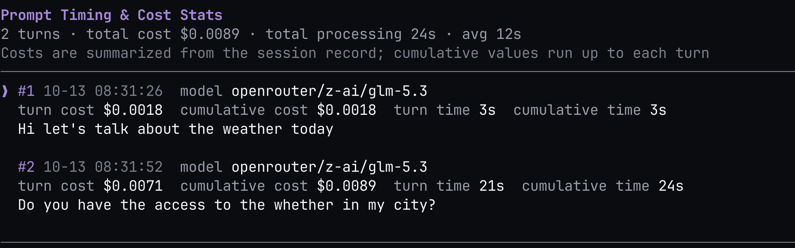

# pi-turn-stats

A [Pi](https://pi.dev) extension that shows model, cost, and processing-time statistics for every user prompt in the current session branch.



## Features

- **`/turns` command** (interactive TUI): a full-screen viewer listing each user prompt in the current branch with:
  - models used in that turn
  - per-turn cost and cumulative cost
  - per-turn and cumulative processing duration
  - average processing time across completed turns
  - jump back to any completed turn with Enter (opens it as a new branch)
- **`get_turn_stats` tool**: returns the same statistics as JSON for the agent to use when reporting the cost of previously completed tasks.

## Install

```bash
pi install npm:pi-turn-stats
```

Or try it once without installing:

```bash
pi -e npm:pi-turn-stats
```

## Keybindings (`/turns`)

| Key | Action |
|---|---|
| `↑` `↓` / `k` `j` | Select turn |
| `PgUp` `PgDn` / `Space` | Page up / down |
| `Home` / `g` | First turn |
| `End` / `G` | Last turn |
| `Enter` | Jump to selected turn (new branch) |
| `Esc` `q` `Ctrl+C` | Close |

## Notes

- `/turns` requires interactive TUI mode; the `get_turn_stats` tool works in all modes.
- Costs are summarized from the session record; cumulative values are up to that turn.
- Turns that have not finished yet are listed but marked as not jumpable, and the tool excludes the still-running turn from its totals.

## License

MIT
